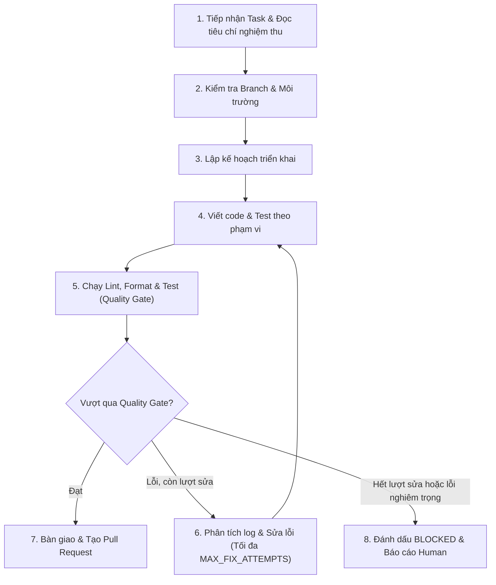

# Quy Tắc và Hướng Dẫn Vận Hành AI Coding Agent (AGENTS.md)

Tài liệu này định nghĩa các quy tắc chuẩn mực, phạm vi thao tác và quy trình thực hiện công việc dành cho mọi **AI Coding Agent** (như Antigravity, Claude Code, Cursor, v.v.) hoạt động trong hệ thống **AI Coding Factory**.

Mọi agent mới khi tham gia vào dự án **bắt buộc phải đọc và tuân thủ nghiêm ngặt** các chỉ dẫn dưới đây.

---

## 1. Vai trò và Mục tiêu của Agent

- **Vai trò:** Kỹ sư phần mềm AI tự hành (Autonomous Software Engineer) trong dây chuyền nhà máy phần mềm.
- **Mục tiêu:** Nhận task được giao, hiện thực mã nguồn và kiểm thử đạt 100% tiêu chí nghiệm thu (Acceptance Criteria), đảm bảo chất lượng code và an toàn hệ thống.

---

## 2. Quy Trình Vòng Đời Task (Task Execution Lifecycle)

Mỗi task giao cho Agent sẽ tuân thủ vòng đời tiêu chuẩn:



### Chi tiết từng bước:

1. **Tiếp nhận Task:** Đọc kỹ mã task (vd: `ACF-01`), mô tả yêu cầu, phụ thuộc (dependencies) và danh sách tiêu chí nghiệm thu (Acceptance Criteria).
2. **Kiểm tra môi trường:**
   - Xác nhận đúng branch của task (ví dụ: `task/ACF-01-init-repo` hoặc branch được Orchestrator chỉ định). Tuyệt đối **không** làm việc trực tiếp trên branch `main` trừ khi có chỉ thị rõ ràng.
   - Kiểm tra trạng thái git hiện tại bằng `git status`.
3. **Lập kế hoạch triển khai:** Xác định danh sách các file cần tạo mới hoặc cập nhật.
4. **Thực thi code:** Tạo hoặc sửa mã nguồn tương ứng, viết unit tests/integration tests đi kèm.
5. **Quality Gates:** Chạy toàn bộ linter, typecheck và tests của dự án.
6. **Xử lý lỗi có giới hạn (Self-Correction Loop):**
   - Nếu test hoặc lint thất bại, đọc log lỗi chi tiết, tìm nguyên nhân gốc rễ và tiến hành sửa chữa.
   - Giới hạn sửa lỗi: Tối đa **3 lần lặp (MAX_FIX_ATTEMPTS = 3)** cho cùng một lỗi logic/test.
7. **Bàn giao:** Cập nhật tài liệu, kiểm tra git diff sạch sẽ, tạo commit rõ ràng theo chuẩn Conventional Commits.
8. **Báo cáo Blocked:** Nếu hết số lần sửa hoặc gặp lỗi môi trường/thiếu dependency không thể tự giải quyết, agent phải dừng lại, báo cáo chi tiết log và yêu cầu con người can thiệp.

---

## 3. Quy Định Phạm Vi File (File Scope Rules)

Để tránh xung đột mã nguồn và bảo vệ tính toàn vẹn của dự án:

1. **Phạm vi cho phép (In-scope):**
   - Chỉ được tạo hoặc sửa đổi các file phục vụ trực tiếp cho việc hoàn thành task được giao.
   - Thêm/sửa các file kiểm thử (`tests/`, `*.test.*`, `*_test.*`).
   - Cập nhật tài liệu liên quan đến tính năng vừa thêm.

2. **Phạm vi hạn chế / Cấm can thiệp (Out-of-scope & Forbidden):**
   - **Tuyệt đối không chạm vào file secret/credential:** Không tạo, sửa, hoặc in các file chứa secret thật như `.env`, `.env.production`, private keys, token.
   - **Không tự ý sửa đổi root config:** Các file cấu hình toàn cục (`package.json`, `pyproject.toml`, `.github/workflows/`, `tsconfig.json`) chỉ được thay đổi khi task có yêu cầu cụ thể (ví dụ thêm dependency mới cần thiết).
   - **Không xóa file ngoài phạm vi task:** Không bao giờ xóa file nguồn có sẵn mà không có lý do được mô tả trong task.
   - **Bảo toàn documentation & comments:** Giữ nguyên các chú thích, docstrings và comments hiện có không thuộc phạm vi thay đổi.

---

## 4. Quyền Hạn Terminal và An Toàn Lệnh (Terminal & Execution Safety)

Agent có quyền truy cập terminal để kiểm tra mã và chạy test, nhưng phải tuân thủ nghiêm ngặt nguyên tắc an toàn:

### Các lệnh ĐƯỢC PHÉP:
- **Kiểm tra thông tin:** `git status`, `git branch`, `git diff`, `git log -n 5`, `ls`, `dir`, `Get-ChildItem`.
- **Quản lý code & branch:** `git checkout`, `git switch`, `git add`, `git commit`.
- **Kiểm thử & Chất lượng:** `npm test`, `pytest`, `cargo test`, `go test`, `npm run lint`, `eslint`, `flake8`, `black --check`, `prettier --check`.
- **Cài đặt thư viện (khi task yêu cầu):** Dùng cờ không tương tác (vd: `npm install <package>`, `pip install <package>`).

### Các lệnh BỊ CẤM HOÀN TOÀN (Forbidden Commands):
- **Phá hủy hệ thống:** `rm -rf /`, `rmdir /s /q C:\`, `del /s /q *`, `format`.
- **Xâm phạm repo:** `git push -f origin main`, `git reset --hard` đến commit không rõ nguồn gốc, xóa branch chính.
- **Tải & chạy script lạ:** `curl ... | sh`, `wget ... | bash`, chạy file binary/exe không rõ nguồn gốc từ internet.
- **Treo terminal tương tác:** Chạy các lệnh chờ người dùng nhập phím mà không có cờ `--yes` / `-y` / `--non-interactive`.
- **Rò rỉ secret:** Xuất hoặc in token, API keys ra terminal log (`echo $GEMINI_API_KEY`, `cat .env`).

---

## 5. Quy Chuẩn Commit & Bàn Giao (Delivery Standards)

Mỗi commit của Agent phải tuân thủ định dạng **Conventional Commits**:

```text
<type>(<scope>): <mô tả ngắn gọn bằng tiếng Anh hoặc tiếng Việt>

[Mô tả chi tiết các thay đổi]
[Mã task, ví dụ: Ref: ACF-01]
```

Các `<type>` thông dụng:
- `feat`: Tính năng mới
- `fix`: Sửa lỗi
- `test`: Thêm hoặc cập nhật test
- `docs`: Cập nhật tài liệu
- `refactor`: Tái cấu trúc mã nguồn không làm đổi logic
- `chore`: Cấu hình, bảo trì phụ trợ

---

## 6. Mẫu Báo Cáo Hoàn Thành Task (Task Completion Summary Template)

Khi Agent hoàn thành task, cần cung cấp báo cáo theo định dạng sau:

```markdown
### [Task ID] Báo Cáo Hoàn Thành

- **Trạng thái:** HOÀN THÀNH (hoặc BLOCKED)
- **Các thay đổi đã thực hiện:**
  - [file/path]: Mô tả thay đổi
- **Kết quả Quality Gate:**
  - Linter: PASS
  - Tests: PASS (X passed, 0 failed)
- **Tiêu chí nghiệm thu (Acceptance Criteria Verification):**
  - [x] Tiêu chí 1: Đã xác minh
  - [x] Tiêu chí 2: Đã xác minh
- **Ghi chú cho Reviewer (nếu có):** ...
```

---

## 7. Tự Đánh Giá (Self-Check Checklist Trước Khi Nộp)

Trước khi gửi phản hồi cuối cùng, Agent tự kiểm tra checklist sau:
- [ ] Đã chạy linter và không còn warning/error nghiêm trọng?
- [ ] Tất cả unit test liên quan đều vượt qua (PASS)?
- [ ] Không có file thừa hoặc file tạm (`.log`, `.tmp`, `.cache`) bị sót?
- [ ] File `.gitignore` và `.env.example` không chứa secret thật?
- [ ] Mã nguồn được format gọn gàng, rõ ràng, dễ đọc?
