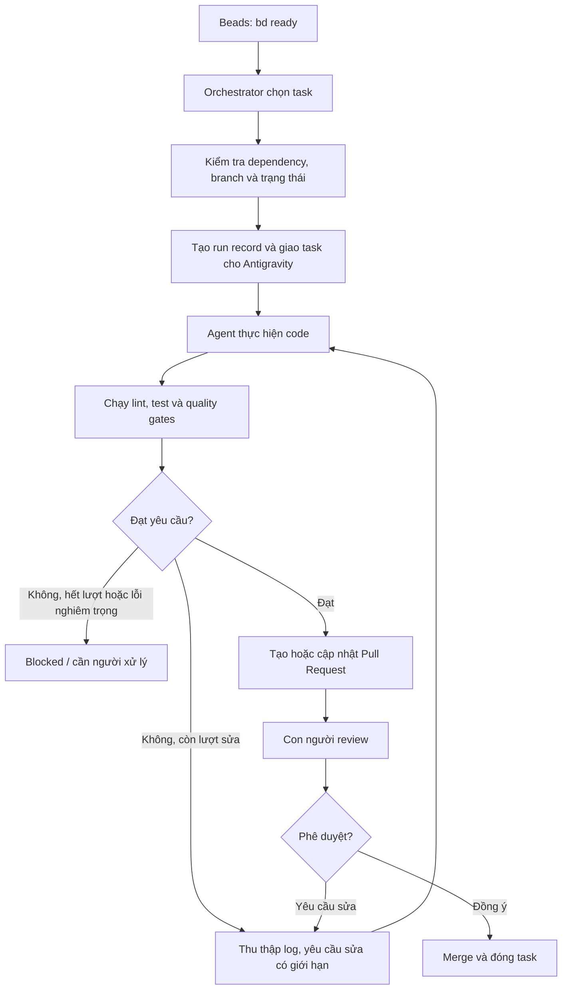

# AI Coding Factory — Xây dựng nhà máy phát triển phần mềm bằng AI

> **AI Coding Factory** là hệ thống tự động hóa dây chuyền phát triển phần mềm: nhận yêu cầu tính năng/bugfix, tự động chia nhỏ công việc, điều phối AI coding agent thực hiện, chạy kiểm thử, đánh giá kết quả và lặp lại cho đến khi đáp ứng toàn bộ tiêu chí nghiệm thu.

---

## 1. Mục Tiêu Dự Án

- Tự động hóa chu trình khép kín từ nhận yêu cầu (Task/Issue) đến sản phẩm hoàn thiện có thể merge vào repository.
- Chuẩn hóa vai trò của AI Coding Agent thành một "công nhân kỹ thuật số" tự hành, hoạt động trong khuôn khổ an toàn và có kiểm soát chất lượng nghiêm ngặt.
- Tối ưu hóa sự tham gia của con người: Người phát triển chỉ cần tập trung định nghĩa yêu cầu, thiết kế kiến trúc và review sản phẩm cuối cùng (Human-in-the-loop).

---

## 2. Quy Trình Vận Hành Hệ Thống

Hệ thống hoạt động dựa trên luồng điều phối tự động giữa Task Manager (Beads), Orchestrator, AI Agent và Human Reviewer:



### Các thành phần chính:
1. **Beads (`bd ready`):** Quản lý trạng thái và danh sách các task sẵn sàng để thực thi dựa trên đồ thị phụ thuộc (DAG).
2. **Orchestrator:** Lõi điều phối phân bổ task, tạo bối cảnh (context), khởi tạo môi trường/branch và giám sát tiến độ của AI Agent.
3. **AI Coding Agent (Antigravity):** Tiếp nhận yêu cầu, đọc mã nguồn, lập kế hoạch, chỉnh sửa code và bổ sung test cases.
4. **Quality Gates:** Bộ lọc kiểm tra tự động gồm Linter, Typecheck, Unit Test và Security Scan.
5. **Self-Correction Engine:** Thu thập log lỗi khi Quality Gate không đạt, gửi phản hồi để Agent tự sửa chữa có giới hạn (`MAX_FIX_ATTEMPTS`).
6. **Human-in-the-loop (Review & Merge):** Reviewer con người phê duyệt Pull Request trước khi merge vào nhánh chính.

---

## 3. Cấu Trúc Thư Mục Dự Án

```text
AI-Coding-Factory/
├── .env.example        # Mẫu biến môi trường (không chứa secret)
├── .gitignore          # Cấu hình bỏ qua các file nhạy cảm và build artifact
├── AGENTS.md           # Quy tắc, phạm vi quyền hạn và chỉ dẫn cho AI Agent
├── README.md           # Tài liệu tổng quan dự án và hướng dẫn sử dụng
├── src/                # Mã nguồn chính của hệ thống Orchestrator & Factory
├── tests/              # Bộ kiểm thử tự động (Unit test, Integration test)
└── docs/               # Tài liệu kiến trúc và hướng dẫn vận hành chi tiết
```

---

## 4. Hướng Dẫn Bắt Đầu (Quick Start)

### 4.1. Yêu cầu hệ thống
- Hệ điều hành: Windows, macOS, hoặc Linux
- Git (phiên bản 2.30 trở lên)
- Node.js (>= 18) hoặc Python (>= 3.10) tùy thuộc vào module thực thi
- CLI Beads (`bd`) đã được cài đặt và cấu hình

### 4.2. Cài đặt môi trường
1. Clone repository về máy:
   ```bash
   git clone <repo-url>
   cd AI-Coding-Factory
   ```

2. Tạo file cấu hình biến môi trường từ mẫu:
   ```bash
   cp .env.example .env
   ```

3. Mở file `.env` và điền các API key / token cần thiết (Lưu ý: **Tuyệt đối không commit file `.env` lên git**).

---

## 5. Quy Chuẩn Dành Cho AI Agent

Tất cả các AI Coding Agent tham gia đóng góp mã nguồn cho dự án này bắt buộc phải tuân theo hướng dẫn chi tiết tại [AGENTS.md](AGENTS.md), bao gồm:
- **Phạm vi file:** Chỉ can thiệp vào các file liên quan trực tiếp đến task được giao.
- **Quyền terminal:** Tuân thủ danh sách lệnh an toàn, không chạy các lệnh phá hủy hệ thống hoặc treo tương tác.
- **Giới hạn số lần sửa lỗi:** Tối đa 3 lần lặp khi gặp lỗi test/lint trước khi chuyển trạng thái sang `BLOCKED`.
- **Chuẩn commit:** Áp dụng định dạng Conventional Commits.

---

## 6. Lộ Trình Phát Triển (Roadmap)

- [x] **ACF-01:** Khởi tạo repository, tài liệu hướng dẫn và quy tắc vận hành Agent (`README.md`, `AGENTS.md`, `.gitignore`, `.env.example`).
- [ ] **ACF-02:** Thiết kế cấu trúc dữ liệu Task và tích hợp công cụ quản lý Beads (`bd`).
- [ ] **ACF-03:** Xây dựng lõi Orchestrator điều phối vòng đời của Agent.
- [ ] **ACF-04:** Tích hợp bộ Quality Gates (Lint, Typecheck, Test Runner).
- [ ] **ACF-05:** Cơ chế Self-Correction và xử lý trạng thái Blocked.
- [ ] **ACF-06:** Tự động hóa tạo Pull Request và tương tác với Human Reviewer.

---

## 7. Đóng Góp & Bản Quyền

Dự án phát triển theo mô hình mã nguồn mở nội bộ. Mọi đóng góp từ lập trình viên và AI Agent đều phải vượt qua các bài kiểm tra tự động và được phê duyệt bởi Maintainer.
