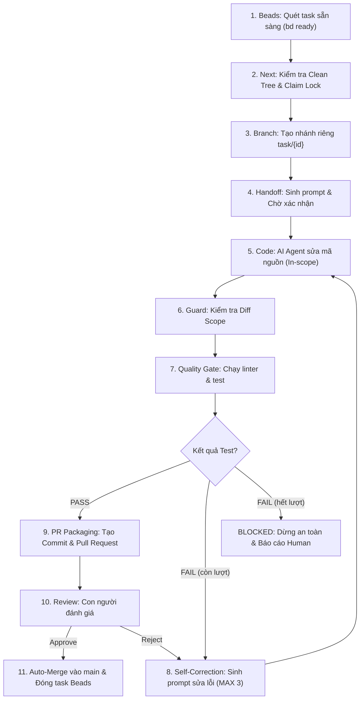

# Sách Hướng Dẫn Vận Hành AI Coding Factory (USER_GUIDE.md)

Chào mừng bạn đến với **AI Coding Factory** — Hệ thống dây chuyền phát triển phần mềm tự hành khép kín kết hợp giữa Task Manager (Beads DAG), Orchestrator điều phối, Git Guard bảo vệ an toàn, Quality Gates tự động, Self-Correction Engine và Human-in-the-loop Review.

Tài liệu này cung cấp hướng dẫn đầy đủ từ chuẩn bị môi trường, tra cứu lệnh CLI, quy trình vận hành từng bước cho đến các kịch bản xử lý sự cố.

---

## MỤC LỤC
1. [Tổng Quan Kiến Trúc & Vòng Đời Task](#1-tổng-quan-kiến-trúc--vòng-đời-task)
2. [Yêu Cầu Hệ Thống & Cài Đặt Môi Trường](#2-yêu-cầu-hệ-thống--cài-đặt-môi-trường)
3. [Bảng Tra Cứu Lệnh CLI (CLI Reference)](#3-bảng-tra-cứu-lệnh-cli-cli-reference)
4. [Hai Chế Độ Vận Hành Chính](#4-hai-chế-độ-vận-hành-chính)
   - [Chế độ 1: Dây Chuyền Tự Hành (Auto-Pilot Mode)](#chế-độ-1-dây-chuyền-tự-hành-auto-pilot-mode)
   - [Chế độ 2: Vận Hành Từng Bước (Interactive Step-by-Step)](#chế-độ-2-vận-hành-từng-bước-interactive-step-by-step)
5. [Hướng Dẫn Tạo Task Mới](#5-hướng-dẫn-tạo-task-mới)
   - [Định dạng Task Contract JSON](#định-dạng-task-contract-json)
   - [Đăng ký Task vào Beads Issue Tracker](#đăng-ký-task-vào-beads-issue-tracker)
6. [Các Cơ Chế An Toàn Cốt Lõi (Safety Guardrails)](#6-các-cơ-chế-an-toàn-cốt-lõi-safety-guardrails)
7. [Cấu Trúc Lưu Trữ Dữ Liệu & Artifacts](#7-cấu-trúc-lưu-trữ-dữ-liệu--artifacts)
8. [Xử Lý Sự Cố Thường Gặp (Troubleshooting & FAQ)](#8-xử-lý-sự-cố-thường-gặp-troubleshooting--faq)

---

## 1. Tổng Quan Kiến Trúc & Vòng Đời Task

Hệ thống hoạt động như một dây chuyền nhà máy phần mềm tự động hóa theo đồ thị phụ thuộc (DAG):



---

## 2. Yêu Cầu Hệ Thống & Cài Đặt Môi Trường

### 2.1. Yêu cầu tiên quyết
- **Hệ điều hành:** Windows 10/11, macOS, hoặc Linux.
- **Python:** Phiên bản `>= 3.10` (dự án được kiểm thử chuẩn trên Python 3.13).
- **Git:** Phiên bản `>= 2.30`.
- **Node.js & npm:** Để chạy công cụ Beads CLI (`npx bd`).

### 2.2. Các bước cài đặt
1. Mở terminal tại thư mục dự án `AI-Coding-Factory`:
   ```powershell
   cd d:\Project\AI-Coding-Factory
   ```

2. Cài đặt các thư viện Python phụ thuộc:
   ```powershell
   pip install -e .
   # Hoặc cài đặt trực tiếp:
   pip install pytest pydantic requests
   ```

3. Thiết lập biến môi trường:
   ```powershell
   cp .env.example .env
   ```
   Mở file `.env` và điền cấu hình nếu bạn muốn đẩy Pull Request lên remote GitHub:
   ```ini
   GITHUB_TOKEN=ghp_your_personal_access_token_here
   GITHUB_REPO=hienluong99/AI-Coding-Factory
   ```
   > [!CAUTION]
   > Tuyệt đối không commit file `.env` thật lên git. File này đã được đưa vào `.gitignore`.

4. Kiểm tra sức khỏe hệ thống:
   ```powershell
   pytest -v
   ```
   Tất cả bài test phải báo `PASSED` (100%).

---

## 3. Bảng Tra Cứu Lệnh CLI (CLI Reference)

Mọi thao tác quản lý nhà máy được thực hiện qua entrypoint: `python -m src.factory <command> [options]`.

| Lệnh (Command) | Các cờ hỗ trợ (Flags) | Ý nghĩa & Mục đích |
|---|---|---|
| `dashboard` | `--json` | Mở Bảng điều khiển trung tâm hiển thị tiến độ DAG, nhánh git, số task ready/blocked, và lịch sử chạy gần đây. |
| `status` | `--json` | Tóm tắt nhanh số lượng task sẵn sàng, bị chặn, khóa đang giữ và các run gần nhất. |
| `next` | `--dry-run`, `--task-id <ID>`, `--owner <ID>`, `--json` | Chọn tuần tự 1 task sẵn sàng tiếp theo. Dùng `--dry-run` để chỉ xem trước các bước dự kiến mà không sửa đổi state. |
| `handoff` | `--task-id <ID>`, `-y/--yes`, `-n/--no`, `--wait`, `--notes "..."`, `--json` | Chuẩn bị prompt, hiển thị thông tin task/branch/acceptance criteria và bàn giao cho Agent. |
| `confirm` | `<RUN_ID>`, `-y/--yes`, `-n/--no`, `--notes "..."`, `--json` | Phê duyệt hoặc từ chối một run đang ở trạng thái `waiting_for_human`. |
| `guard` | `--task-id <ID>`, `--base main`, `--json` | Kiểm tra Working Tree sạch và kiểm tra toàn bộ diff đảm bảo không vi phạm ngoài phạm vi `in_scope`. |
| `quality` *(alias: `test`)* | `<TASK_ID>`, `--run-id <ID>`, `--timeout <SEC>`, `--no-record`, `--json` | Thực thi tự động toàn bộ `test_commands` của task, thu thập log streaming và ghi nhận attempt vào SQLite. |
| `fix` *(alias: `correct`)* | `<RUN_ID>`, `--json` | Phân tích log lỗi test, trích xuất nguyên nhân gốc rễ (Root Cause), sinh fix prompt hoặc chuyển trạng thái sang `BLOCKED`. |
| `pr` *(alias: `delivery`)* | `<TASK_ID>`, `--run-id <ID>`, `--base main`, `--local`, `--no-push`, `--json` | Đóng gói bàn giao, tạo Conventional Commit và tạo Pull Request (trên GitHub hoặc bundle cục bộ). |
| `review` | `<TASK_ID>`, `-y/--approve`, `--reject`, `--feedback "..."`, `--reviewer <NAME>`, `--base main`, `--json` | Hiển thị tóm tắt diff & test cho reviewer; phê duyệt auto-merge hoặc gửi feedback yêu cầu sửa đổi. |
| `auto-pilot` *(alias: `loop`, `run-all`)* | `--max-tasks <N>`, `--task-ids ...`, `--dry-run`, `--require-review`, `--continue-on-blocked`, `--base main`, `--push`, `--json` | Chạy dây chuyền tự hành khép kín toàn bộ đồ thị task DAG từ A-Z không cần can thiệp thủ công. |
| `release` | `<TASK_ID>` | Giải phóng khóa độc quyền (lock) của một task khi cần can thiệp gỡ kẹt. |

---

## 4. Hai Chế Độ Vận Hành Chính

### Chế độ 1: Dây Chuyền Tự Hành (Auto-Pilot Mode)

Phù hợp khi bạn muốn nhà máy tự động quét hàng đợi Beads, thực hiện liên tục các task cho đến khi hoàn thành toàn bộ đồ thị DAG.

#### 1. Mô phỏng thử nghiệm an toàn (Dry-Run):
Xem trước lộ trình các task sẽ được xử lý mà tuyệt đối không thay đổi code hay khóa database:
```powershell
python -m src.factory auto-pilot --dry-run
```

#### 2. Chạy tự hành 1 task tiếp theo:
```powershell
python -m src.factory auto-pilot --max-tasks 1
```

#### 3. Chạy tự hành toàn bộ nhưng dừng chờ con người review trước khi merge:
```powershell
python -m src.factory auto-pilot --require-review
```

#### 4. Chạy tự hành hoàn toàn (Full Autonomous Loop):
```powershell
python -m src.factory auto-pilot
```

---

### Chế độ 2: Vận Hành Từng Bước (Interactive Step-by-Step)

Phù hợp khi bạn muốn giám sát chặt chẽ từng giai đoạn của một task quan trọng.

#### Bước 1: Xem Dashboard & Chọn Task
```powershell
python -m src.factory dashboard
python -m src.factory next --dry-run
```

#### Bước 2: Bàn Giao Task (Handoff)
```powershell
python -m src.factory handoff --task-id ACF-XX -y
```
Hệ thống sẽ:
- Kiểm tra working tree sạch.
- Khóa task độc quyền (`runs/locks/ACF-XX.lock`).
- Tự động tạo và chuyển sang nhánh `task/ACF-XX`.
- Tạo thư mục `runs/<run_id>/` chứa prompt chi tiết cho Agent.

#### Bước 3: AI Coding Agent Thực Hiện Code
Agent sửa code và thêm tests theo chỉ dẫn trong `antigravity_prompt.md`.

#### Bước 4: Kiểm Tra Phạm Vi Diff (Diff Guard)
```powershell
python -m src.factory guard --task-id ACF-XX
```
Nếu có file lạ ngoài `in_scope`, hệ thống sẽ chặn đứng để bảo vệ an toàn.

#### Bước 5: Chạy Quality Gate
```powershell
python -m src.factory quality ACF-XX --run-id <RUN_ID>
```
Nếu test trượt:
```powershell
python -m src.factory fix <RUN_ID>
```
File `runs/<run_id>/fix_prompt_attempt_2.md` sẽ được sinh ra để Agent đọc lỗi và sửa lại.

#### Bước 6: Đóng Gói Pull Request
```powershell
# Tạo bundle cục bộ an toàn:
python -m src.factory pr ACF-XX --local

# Hoặc đẩy lên GitHub remote:
python -m src.factory pr ACF-XX
```

#### Bước 7: Review & Phê Duyệt Tự Động Merge
Xem tóm tắt thay đổi:
```powershell
python -m src.factory review ACF-XX
```

- **Nếu đồng ý:** Phê duyệt để tự động merge `--no-ff` vào `main`, giải phóng khóa và đóng task trong Beads:
  ```powershell
  python -m src.factory review ACF-XX --approve
  ```

- **Nếu chưa ưng ý:** Yêu cầu sửa đổi kèm feedback:
  ```powershell
  python -m src.factory review ACF-XX --reject --feedback "Vui lòng bổ sung thêm kiểm thử cho trường hợp timeout"
  ```

---

## 5. Hướng Dẫn Tạo Task Mới

### Định dạng Task Contract JSON
Mỗi task trong hệ thống phải có một hợp đồng định dạng JSON đặt tại `tasks/<TASK_ID>.json`:

```json
{
  "id": "FEATURE-01",
  "objective": "Mô tả ngắn gọn mục tiêu tính năng",
  "description": "Chi tiết yêu cầu kỹ thuật cần đạt được",
  "scope": {
    "in_scope": [
      "src/feature/*",
      "tests/test_feature.py",
      "tasks/FEATURE-01.json"
    ],
    "out_of_scope": [
      ".env",
      ".env.*",
      "*.pem",
      "*.key"
    ]
  },
  "constraints": {
    "max_fix_attempts": 3,
    "timeout_seconds": 300,
    "forbidden_commands": [
      "rm -rf /",
      "git push -f",
      "format"
    ],
    "branch_pattern": "task/{id}"
  },
  "acceptance_criteria": [
    "Tiêu chí nghiệm thu 1: Module hoạt động đúng chức năng",
    "Tiêu chí nghiệm thu 2: Toàn bộ bài test trong test_feature.py PASS 100%"
  ],
  "test_commands": [
    "pytest tests/test_feature.py"
  ],
  "dependencies": [],
  "status": "ready"
}
```

### Đăng ký Task vào Beads Issue Tracker
Sử dụng lệnh Beads CLI để tạo task trong cơ sở dữ liệu phân tán Dolt:

```powershell
# Tạo task độc lập
npx bd create "Mô tả tiêu đề task" --id FEATURE-01 --force

# Tạo task phụ thuộc (FEATURE-02 chỉ sẵn sàng khi FEATURE-01 đã đóng)
npx bd create "Tính năng tiếp theo" --id FEATURE-02 --deps blocks:FEATURE-01 --force
```

Sau khi tạo, kiểm tra lại hàng đợi sẵn sàng bằng:
```powershell
python -m src.factory status
```

---

## 6. Các Cơ Chế An Toàn Cốt Lõi (Safety Guardrails)

Để đảm bảo AI không phá hủy hệ thống hoặc ghi đè code dở dang của con người, Factory tích hợp 4 tầng bảo vệ:

1. **Working Tree Cleanliness Guard:** Không bao giờ chuyển nhánh hoặc claim task mới nếu thư mục làm việc đang có thay đổi chưa commit của người dùng.
2. **Diff Scope Guard:** Đối chiếu danh sách file bị sửa đổi so với `in_scope` và `out_of_scope` trong hợp đồng. Nếu Agent sửa file cấu hình nhạy cảm (`.env`, `package.json`, root config ngoài phạm vi), hệ thống dừng ngay lập tức.
3. **Atomic Task Lock:** Khóa task nguyên tử qua file PID trong `runs/locks/`. Ngăn chặn hai tiến trình/worker cùng lúc can thiệp vào một task.
4. **Self-Correction Circuit Breaker:** Giới hạn tối đa 3 lần sửa (`MAX_FIX_ATTEMPTS = 3`). Nếu sau 3 lần vẫn trượt test, task tự động chuyển sang trạng thái `BLOCKED` và dừng an toàn, tránh vòng lặp vô tận gây tốn token và treo máy.

---

## 7. Cấu Trúc Lưu Trữ Dữ Liệu & Artifacts

Trong quá trình vận hành, hệ thống lưu trữ toàn bộ trạng thái tại thư mục `runs/`:

```text
runs/
├── factory.db              # SQLite Database lưu trữ bảng runs và test_results
├── locks/                  # Thư mục chứa các khóa độc quyền (.lock)
│   └── <TASK_ID>.lock      # Chứa thông tin tiến trình sở hữu khóa (PID, owner, timestamp)
└── <run_id>/               # Thư mục artifact riêng của từng lượt chạy
    ├── antigravity_prompt.md         # Prompt hướng dẫn sinh ra cho Agent
    ├── handoff_packet.json           # Dữ liệu ngữ cảnh bàn giao
    ├── attempt_1_quality_gate.log    # Log streaming chi tiết của lệnh test
    ├── fix_prompt_attempt_2.md       # Prompt hướng dẫn sửa lỗi nếu attempt 1 fail
    ├── pr_summary.md                 # Báo cáo nghiệm thu bàn giao Pull Request
    └── pr_package.json               # Dữ liệu JSON của PR
```

---

## 8. Xử Lý Sự Cố Thường Gặp (Troubleshooting & FAQ)

### Q1: Gặp lỗi `Factory dừng an toàn: Working tree đang có thay đổi chưa commit`
- **Nguyên nhân:** Bạn hoặc Agent đang có file sửa đổi dở dang trên nhánh hiện tại.
- **Cách xử lý:** 
  - Xem danh sách file: `git status`
  - Nếu muốn giữ lại: Commit thay đổi (`git commit -m "..."`) hoặc lưu tạm (`git stash`).
  - Nếu muốn hủy bỏ thay đổi tạm: `git restore .`

### Q2: Gặp lỗi `Task 'ACF-XX' phát hiện diff vi phạm phạm vi file cho phép`
- **Nguyên nhân:** Agent đã chỉnh sửa file không nằm trong danh sách `in_scope` của task contract.
- **Cách xử lý:** 
  - Kiểm tra diff: `python -m src.factory guard --task-id ACF-XX`
  - Revert file ngoài phạm vi: `git restore <file-ngoài-phạm-vi>`
  - Hoặc nếu file đó thực sự cần thiết: Cập nhật thêm đường dẫn file đó vào mảng `in_scope` trong file `tasks/ACF-XX.json`.

### Q3: Gặp lỗi `Task 'ACF-XX' đã bị claim và đang bị khóa bởi tiến trình khác`
- **Nguyên nhân:** Một worker trước đó bị tắt đột ngột và chưa kịp nhả khóa.
- **Cách xử lý:** Giải phóng khóa thủ công bằng lệnh:
  ```powershell
  python -m src.factory release ACF-XX
  ```

### Q4: Task bị chuyển sang trạng thái `BLOCKED`
- **Nguyên nhân:** Agent đã thử sửa lỗi quá 3 lần (`MAX_FIX_ATTEMPTS`) mà test vẫn không vượt qua.
- **Cách xử lý:**
  - Đọc file chẩn đoán lỗi: `runs/<run_id>/blocked_diagnostic.json`
  - Xem log chi tiết: `runs/<run_id>/attempt_3_quality_gate.log`
  - Con người can thiệp sửa trực tiếp nguyên nhân gốc rễ, sau đó chạy lại:
    ```powershell
    python -m src.factory quality ACF-XX
    ```

### Q5: Lệnh Beads báo `bd : The term 'bd' is not recognized`
- **Nguyên nhân:** Máy tính chưa cài đặt biến môi trường toàn cục cho `bd`.
- **Cách xử lý:** Hệ thống đã được cấu hình mặc định sử dụng `npx bd`. Khi cần gõ lệnh Beads thủ công, hãy dùng `npx bd <command>` (ví dụ: `npx bd ready`, `npx bd list`).

---

*Tài liệu được phát hành và duy trì bởi đội ngũ kiến trúc sư AI Coding Factory.*
